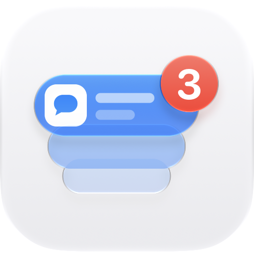
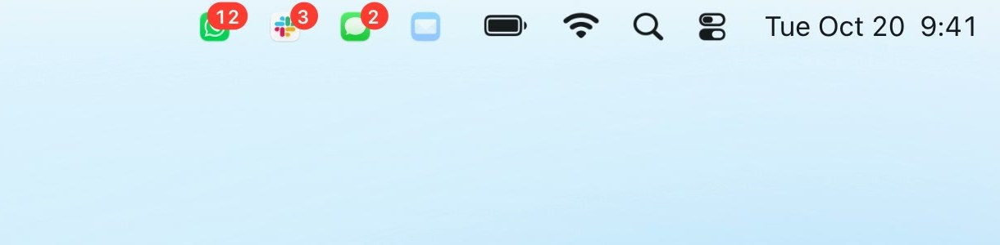
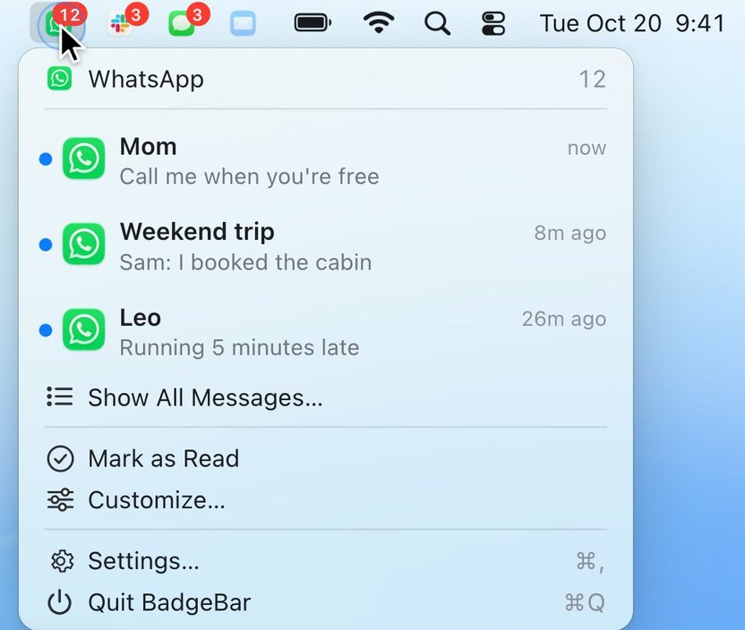
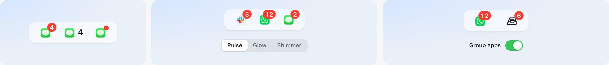

<p align="center">
  <picture>
    <source media="(prefers-color-scheme: dark)" srcset="apps/web/public/badgebar-dark.png">
    
  </picture>
</p>

<h1 align="center">BadgeBar</h1>

<p align="center">
  Hide the Dock. Keep the badges.<br>
  Your apps' unread counts in the macOS menu bar, one icon per app.
</p>

<p align="center">
  <a href="#getting-started">Install</a> ·
  <a href="https://badgebar.hari.works">Website</a> ·
  <a href="#build">Build from source</a>
</p>

<p align="center">
  
</p>

Apps show unread counts on their Dock icons, which is no help once the Dock is hidden. BadgeBar
gives each app its own menu bar icon with its count on top, so you see what's new without bringing
the Dock back.

Free and open source. Needs macOS 14 or later, on Apple silicon or Intel.

## Features



**One icon per app.** Any app that shows a badge on the Dock can have a menu bar icon. Icons dim
when there's nothing new, or you can hide them until something arrives.

**Click to open, right-click to read.** Click an icon to open its app, like the Dock. Right-click
it to see who wrote and what they said, mark everything as read, or show all its messages.

**Apps you haven't added still show up.** Any app with a badge appears on its own until its badge
clears, so nothing slips by.

**Arrange them your way.** Drag icons in Settings and the menu bar follows, or ⌘-drag them in the
menu bar itself. Works alongside Bartender, Ice and Hidden Bar.

<br clear="right">

<picture>
  <source media="(prefers-color-scheme: dark)" srcset="docs/media/features-dark.jpg">
  
</picture>

**Badge styles.** Show the count on the icon, the number beside it, or just a dot. Set it once
for every app, or per app.

**Notice what just arrived.** When a count goes up, its badge can pulse, glow or shimmer for a
moment. Turn on *Keep animating* to repeat it every few seconds until you read it. With Reduce
Motion on, every effect becomes a gentle glow.

**Groups.** Put related apps under one icon that shows their total. Give a group any SF Symbol or
your own image. Clicking it lists messages from all its apps.

**Your icons, your colors.** Use each app's own icon, a monochrome version, an SF Symbol from the
built-in library, or an image you drop in.

**Hide apps that aren't open.** An icon can disappear when you quit its app and come back when you
open it.

**Light and dark app icon.** Pick Automatic, Light or Dark in Settings.

## Getting started

1. Install with [Homebrew](https://brew.sh):

   ```sh
   brew install --cask hk-vk/tap/badgebar
   ```

   Or download the zip from the [latest release](https://github.com/hk-vk/badgebar/releases/latest)
   and move BadgeBar to Applications. BadgeBar isn't notarized by Apple, so the first time you
   open a downloaded copy, macOS blocks it: click *Open Anyway* in System Settings ▸ Privacy &
   Security. Homebrew installs skip this step.
2. Open BadgeBar. A short guide asks for **Accessibility** access, which BadgeBar needs to read the
   badges. It notices as soon as you allow it.
3. Pick the apps you want to keep in the menu bar, or skip this. Apps with a badge show up anyway.
4. Optionally, allow **Full Disk Access** to read message text in the right-click menu. Without it,
   you still get the counts.

That's it. There's no account and nothing else to configure. To update, run
`brew upgrade --cask badgebar`; your permissions carry over.

## Privacy

BadgeBar never connects to the internet. Message text is read from Notification Center's history
on your Mac and stays there. Marking messages as read only hides them in BadgeBar; macOS doesn't let
other apps change Notification Center or an app's own badge.

## How it works

macOS draws app badges on Dock tiles. The Dock exposes each tile through the Accessibility API as
an `AXApplicationDockItem`, and the tile's `AXStatusLabel` attribute holds the badge text.
BadgeBar reads that attribute every 1.5 seconds by default, and right away when an app launches or
quits. So:

- BadgeBar needs **Accessibility** permission to read badges.
- An app must be **running** to report a badge. The Dock can stay hidden.
- Message previews come from Notification Center's history in
  `~/Library/Group Containers/group.com.apple.usernoted/db2/db`, which needs **Full Disk Access**.

## Build

You need Xcode 16 or later and macOS 14 or later.

```sh
cd apps/macos
scripts/create-signing-cert.sh  # once: a local signing identity so permissions survive rebuilds
scripts/build-app.sh            # build/BadgeBar.app, for Apple silicon and Intel
scripts/build-app.sh "Developer ID Application: …"   # signed with your identity
open build/BadgeBar.app
```

For development, use `swift build && .build/debug/BadgeBar` in `apps/macos`. Accessibility
permission is then granted to your terminal.

> macOS ties privacy permissions to the app's code signature. An ad-hoc signature changes on every
> build, so a permission granted to one build silently stops working for the next, even though the
> switch in System Settings still looks on. Sign with the local identity from
> `scripts/create-signing-cert.sh` to avoid this. To clear a stale entry, run
> `tccutil reset Accessibility io.github.hk-vk.badgebar`.

The app icon is an Icon Composer document, `apps/macos/Resources/AppIcon.icon`. Edit it in Icon
Composer (Xcode ▸ Open Developer Tool). `scripts/build-app.sh` compiles it, and
`scripts/make-icon.sh` re-renders the light and dark PNGs used by the App Icon setting.

## Repository layout

| Folder | What's in it |
| --- | --- |
| `apps/macos` | The BadgeBar app, a Swift package |
| `apps/web` | The website, built with Astro, React and Tailwind |
| `docs/media` | Images for this README |

To work on the website, run `pnpm install` once and then `pnpm dev`. Pushing to `main` deploys it
to [badgebar.hari.works](https://badgebar.hari.works) through GitHub Pages.

The main files of the app, in `apps/macos/Sources/BadgeBar`:

| File | Purpose |
| --- | --- |
| `DockReader.swift` | Reads badges from the Dock's accessibility tree |
| `BadgeMonitor.swift` | Polls the Dock and publishes changes |
| `BadgeRenderer.swift` | Draws the icon and badge images |
| `BadgeEffects.swift` | Plays the pulse, glow and shimmer effects |
| `StatusBarController.swift` | Creates the menu bar items, menus and click handling |
| `SettingsView.swift` | The Settings window (SwiftUI) |
| `OnboardingView.swift` | The first-run guide |
| `Store.swift`, `Models.swift` | Configuration, saved to UserDefaults |

## License

MIT
